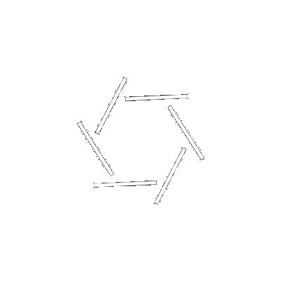

     
    </img>

👋 Bem-vindo ao meu perfil!

## Sobre Mim
Olá! Eu sou Cauã Marinho, um entusiasta da tecnologia com paixão por desenvolvimento de software e resolução de problemas complexos. Minha jornada de aprendizado abrange uma variedade de áreas, desde as metodologias de desenvolvimento até as ferramentas mais modernas. Com uma mente curiosa e uma abordagem disciplinada, estou sempre pronto para mergulhar de cabeça em novos desafios.

##  Habilidades

	
	
	
	
	
	
	

		
	

	

